# Wazir: chess.com game review, stats & Chess Wrapped

[](https://developer.chrome.com/docs/extensions/mv3/intro/)
[](./CONTRIBUTING.md)
[](https://stockfishchess.org/)
[](web/README.md)

Wazir is two things:

- **[The website](#the-website)**: a one-stop site for any chess.com player. Engine-grade game review, stats and
  rating progress, and a monthly and yearly **Chess Wrapped** with its own soundtrack. Everything runs in the
  browser: no sign-up, no backend, no cost.
- **[The Chrome extension](#the-chrome-extension)**: review the finished game you're looking at, right on chess.com.

> Not affiliated with Chess.com.


---

## Table of Contents

- [The website](#the-website)
  - [Game Review](#game-review)
  - [Stats & progress](#stats--progress)
  - [Chess Wrapped](#chess-wrapped)
  - [How accurate is it?](#how-accurate-is-it)
  - [Run it locally](#run-it-locally)
- [The Chrome extension](#the-chrome-extension)
- [Project structure](#project-structure)
- [Contributing](#contributing)
- [Credits](#credits)

---

## The website

Enter a chess.com username and you get everything in one place. The site calls chess.com's public API straight from
the browser and runs **Stockfish 19** (full NNUE, multi-threaded) as WebAssembly on your own device.
Details for developers are in [`web/README.md`](web/README.md).

### Game Review

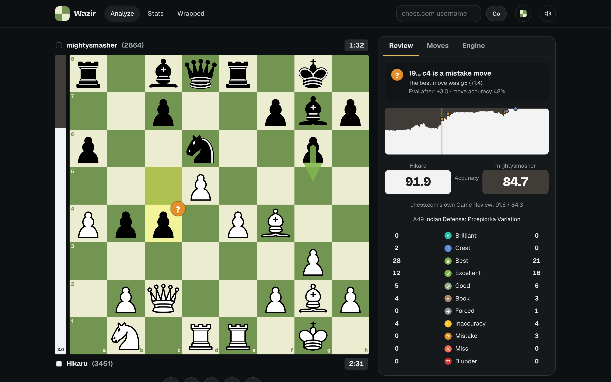

- **Accuracy** for both players, calibrated against chess.com's own Game Review (the screenshot shows Wazir
  91.9 / 84.7 next to chess.com's 91.6 / 84.3 for the same game)
- **Move classifications**: Brilliant, Great, Best, Excellent, Good, Book, Forced, Inaccuracy, Mistake, Miss, Blunder
- A plain-language explanation of every move, with the best alternative drawn on the board
- Eval bar, clickable eval graph, accuracy per game phase, average centipawn loss
- **Engine tab**: the top 3 lines at every position, a depth picker (14 / 18 / 22 / 28) and a full or lite engine
- **Explore freely**: move pieces yourself and the engine follows your line live
- **Board sounds** for moves, captures, castling, checks and mate, plus green (chess.com style) or wood boards

| Engine lines | On a phone |
| --- | --- |
| 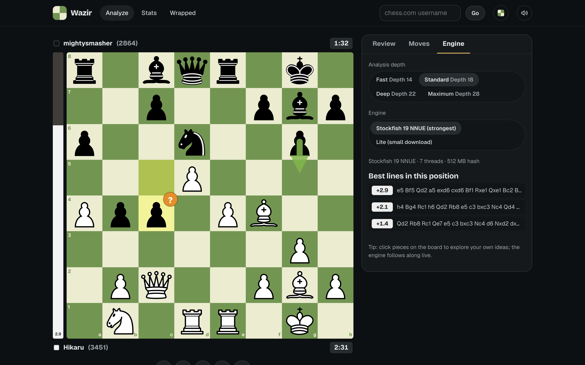 | 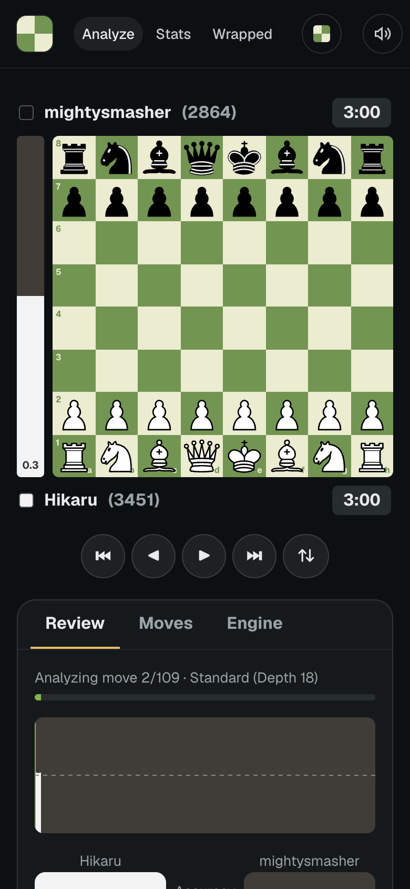 |

Load a game from your games list, paste a chess.com game link, or paste any PGN.

### Stats & progress

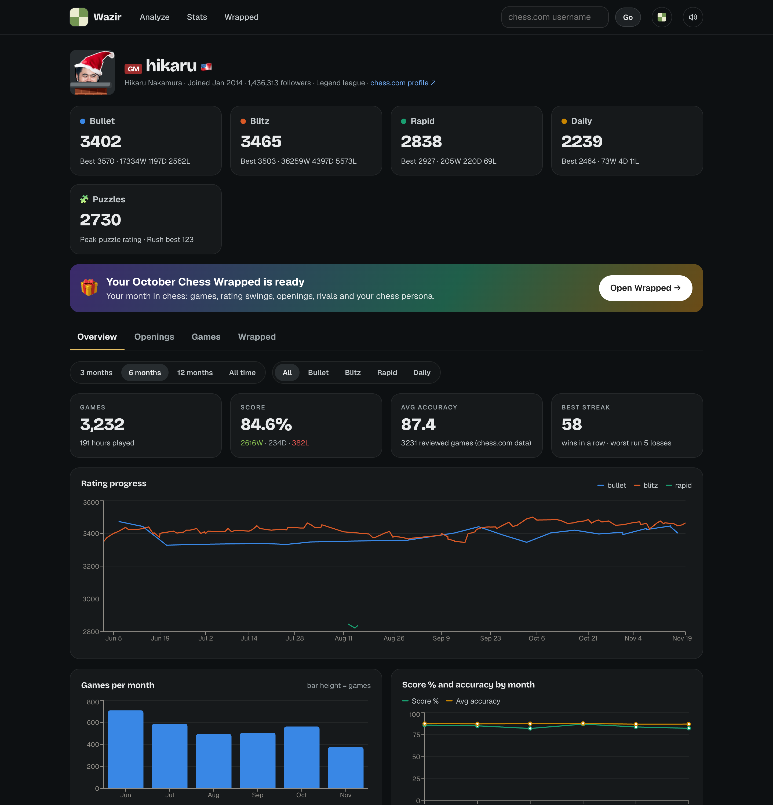

- Current and best rating for bullet, blitz, rapid, daily and puzzles
- Rating history per time control over 3, 6 or 12 months or all time
- Games per month, score and accuracy trends
- Results by color, by opponent strength, by time of day and day of week
- How your games end (checkmates, resignations, timeouts), streaks and best wins

| Opening repertoire | Every game, one click to review |
| --- | --- |
| 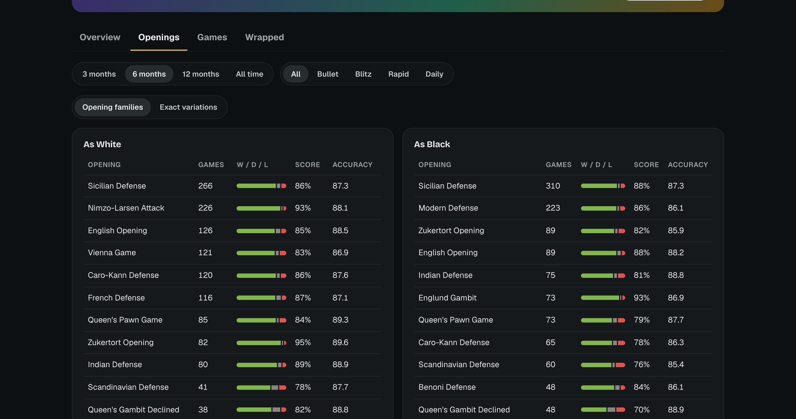 | 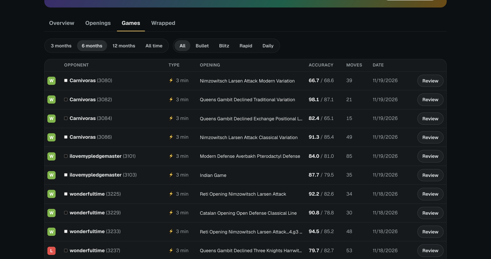 |

### Chess Wrapped

Your month (or year) in chess as story slides, like Spotify Wrapped. A new monthly Wrapped is ready as soon as each
month ends, and the year Wrapped is final after December 31.

| Tap to play | Rating journey | Signature openings | Your persona | Share card |
| --- | --- | --- | --- | --- |
| 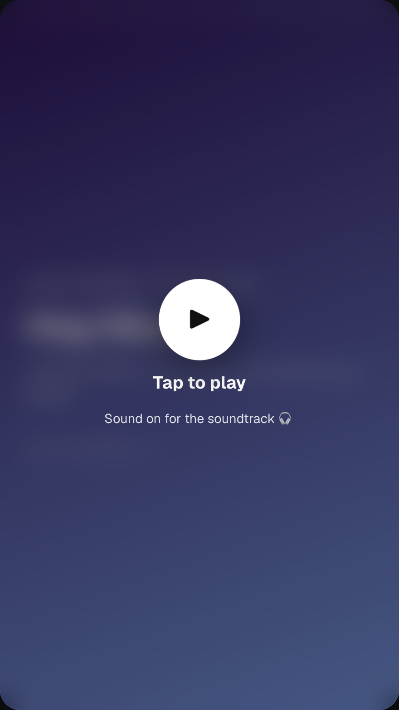 | 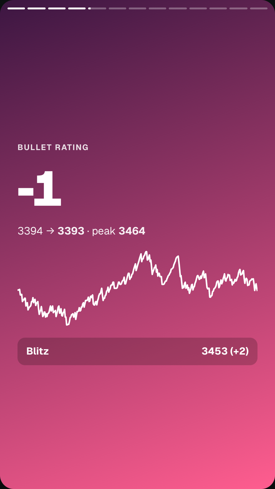 | 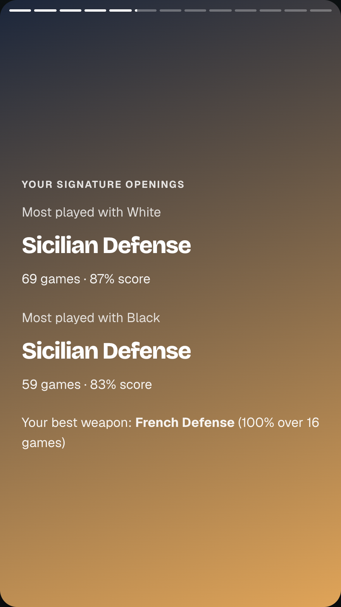 |  | 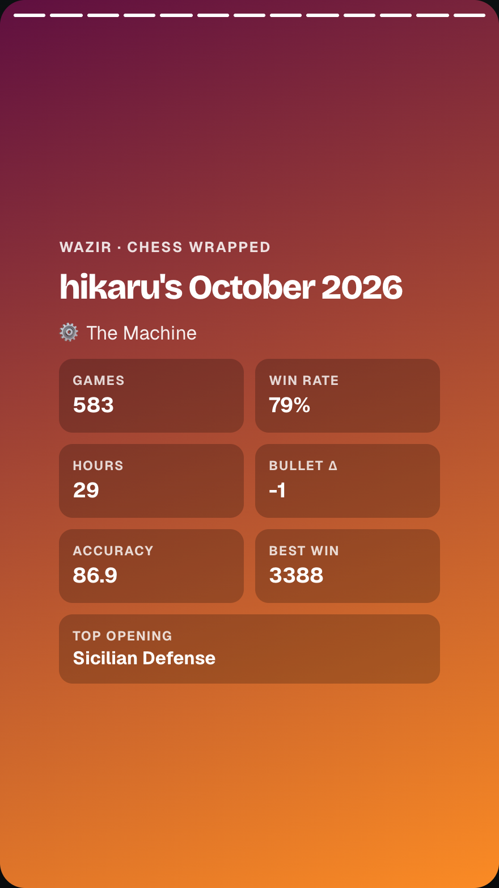 |

- Games played, hours at the board, win rate and change from last period
- Rating journey, signature openings, biggest win, nemesis and most-played rival
- When you play, how your games end, longest win streak, busiest month (year view)
- A **chess persona** (The Machine, The Night Owl, The Climber, The Surgeon…)
- **A soundtrack**: five original tracks generated live in the browser, matched to your persona. You can also add
  music you have the rights to (see [`web/public/music/README.md`](web/public/music/README.md))
- Download the summary as an image, or share the link

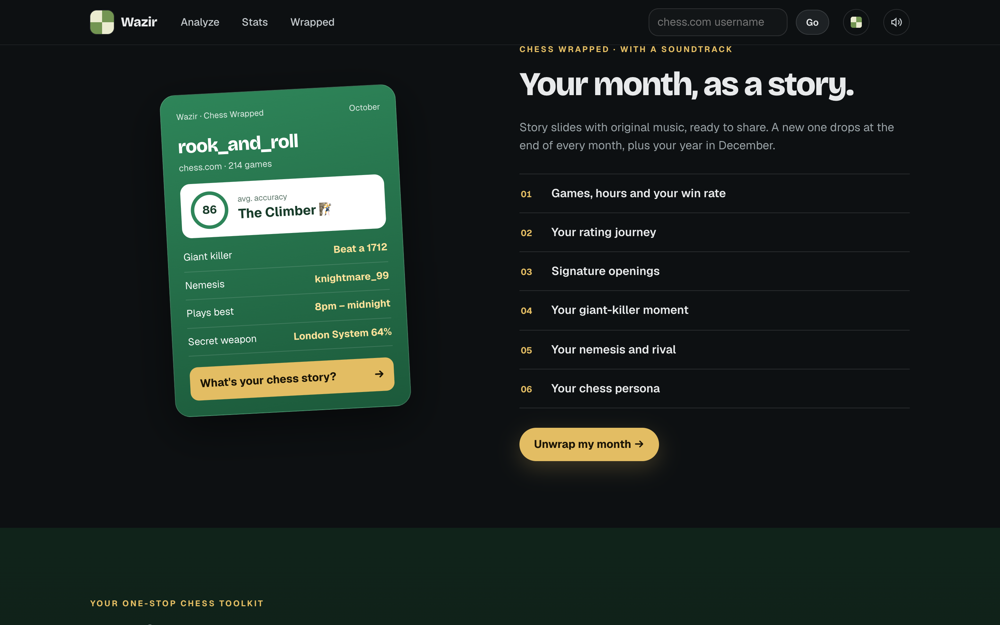

### How accurate is it?

Chess.com's accuracy formula (CAPS2) is private, so Wazir's is **fitted to chess.com's own published numbers**.
We analyzed 56 games that chess.com had already reviewed, from players rated about 200 to 3000, and tuned the model
until it matched:

| Model | Average gap from chess.com's accuracy |
| --- | --- |
| Standard open-source formula (lichess constants) | 7.4 points |
| **Wazir, fitted** (tested on games it wasn't fitted on) | **4.1 points** |
| Wazir, spot check on a later month of unseen games | 2.7 points |

The biggest fix: one blunder in a short game no longer drags the score toward zero, which is where the standard
formula disagreed most with chess.com. Move labels use chess.com's published expected-points thresholds, and Book
moves come from a 3,800-line opening database. When chess.com has already reviewed a game, its own accuracy is shown
next to Wazir's so you can compare.

### Run it locally

```bash
cd web
npm install      # also copies Stockfish 19 into public/engine
npm run dev      # http://localhost:5173
```

Deployment notes (cross-origin isolation headers, hosting the ~99 MB engine file) are in
[`web/README.md`](web/README.md#deploy).

---

## The Chrome extension

The extension analyzes **finished Chess.com games** locally using **Stockfish 17.1 Lite** and produces a
Chess.com-style review: **accuracy**, **ACPL**, move tags, charts, a move list, and an interactive board replay
with PV lines. [Install it from the Chrome Web Store](https://chromewebstore.google.com/detail/wazir/pmmbehjgblpgcjmggmckeaophifjmilk).

### Features

- Fetch PGN from the current Chess.com game tab
- Local analysis using Stockfish 17.1 Lite (Web Worker)
- Chess.com-style **accuracy** model (win-probability based)
- **ACPL** and move classification:
  - book, good, excellent, best
  - inaccuracy, mistake, blunder
  - (plus great/brilliant heuristics)
- Charts:
  - advantage over time
  - accuracy per move
- Move list with click-to-jump
- Board view:
  - arrows for best line (PV)
  - MultiPV switching (PV1/PV2/PV3)
  - navigation + flip
  - quick filters (blunders/mistakes/brilliants/best)

### Screenshots

| Summary | Move list | Board |
| --- | --- | --- |
| 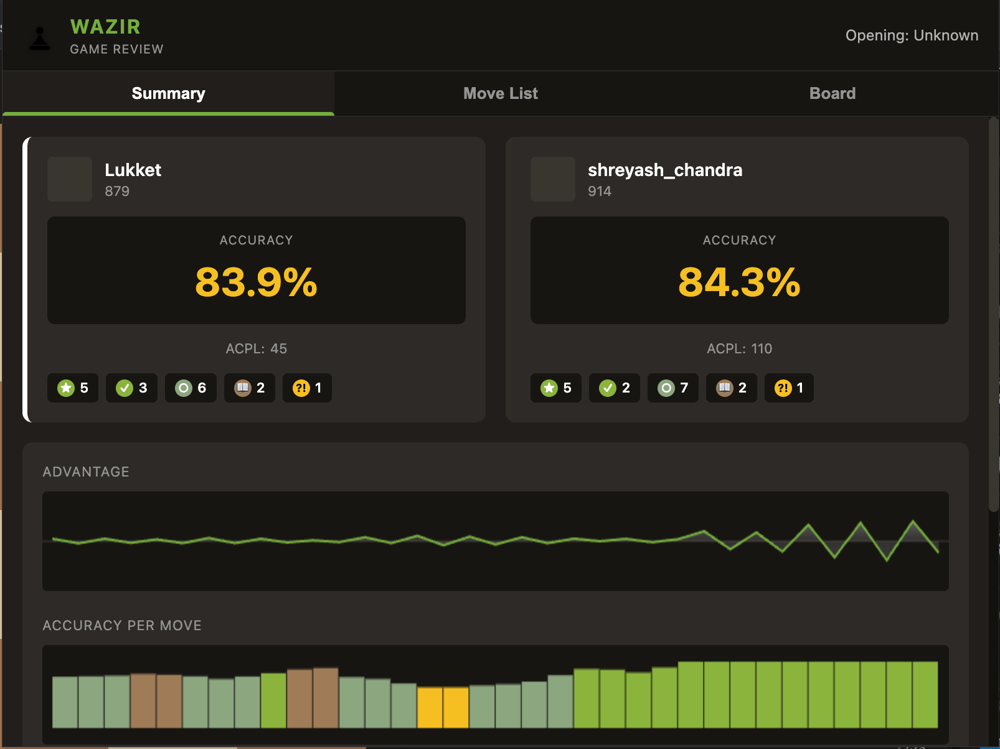 | 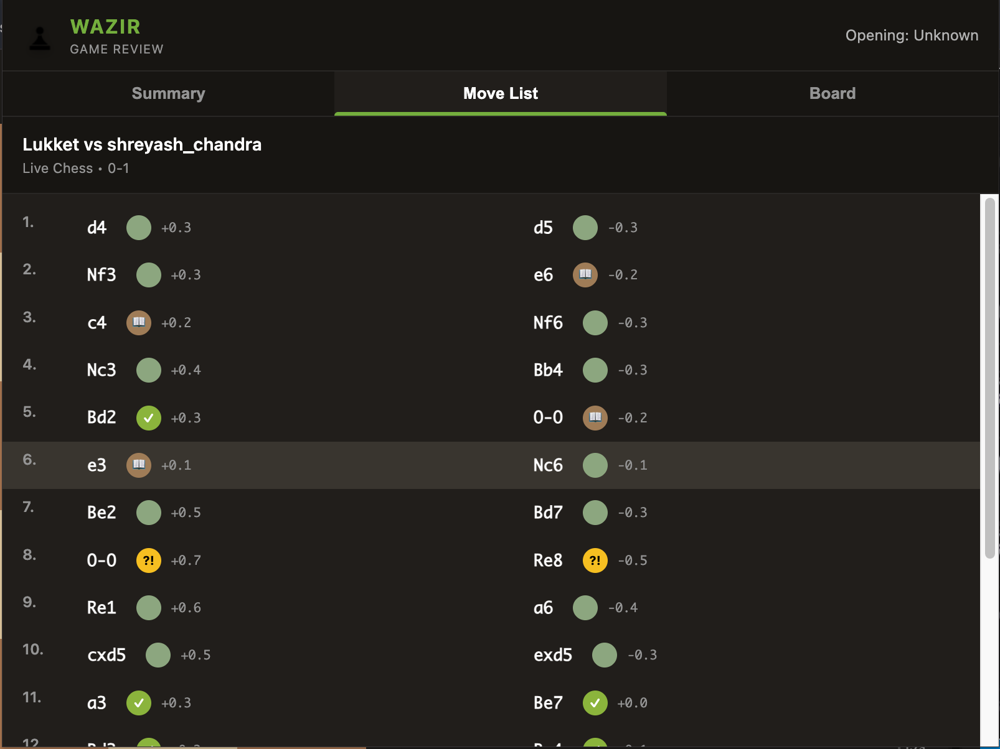 | 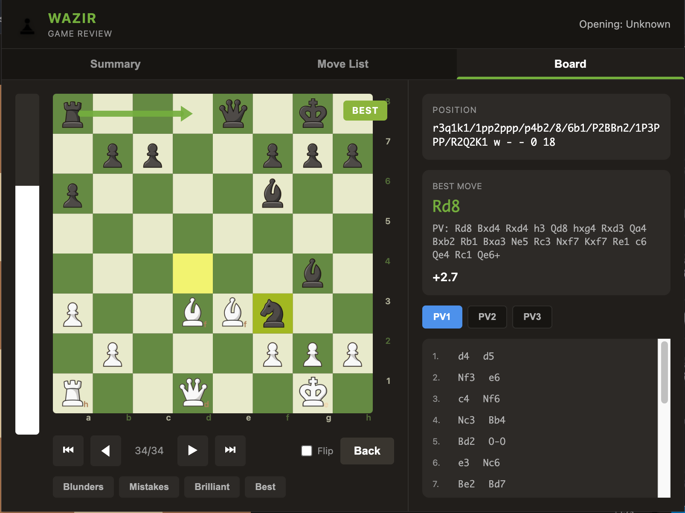 |

### How it works

1. **content.js** runs on Chess.com pages and extracts:
   - game id (live/daily/analysis URLs)
   - usernames (DOM + fallback signals)
   - timestamp/month (via Chess.com callback JSON when available)
2. **popup.js**:
   - requests context from the active tab
   - fetches the PGN from a small API (Cloudflare Worker) using username + year/month
   - parses PGN headers + SAN moves
   - runs Stockfish analysis per ply:
     - MultiPV on the position before the move
     - evaluation of the played move
   - converts eval → win% → accuracy (Chess.com-like model)
   - renders Summary / Move List / Board tabs
3. **Backend (Worker)** provides:
   - `GET /pgn?username=...&year=YYYY&month=MM`
   - returns an array of `{ gameID, PGN }`

### Install (unpacked / dev)

1. Open `chrome://extensions` and turn on **Developer mode**
2. Click **Load unpacked** and select the `extention/` folder
3. Open a finished game on chess.com and click the Wazir icon

---

## Project structure

```text
web/                   The website (React + Vite + TypeScript)
  src/lib/             chess.com API client, Stockfish wrapper, accuracy model,
                       classification, stats, Wrapped, sounds, music
  src/pages/           Home, Review, Player (stats), Wrapped, Privacy
  tests/               unit tests + chess.com calibration scripts
  docs/screenshots/    images used in these READMEs
extention/             The Chrome extension (Manifest V3)
  manifest.json, popup.html, popup.js, popup-ui.js, content.js, styles.css
  lib/chess.js, stockfish/*.js|wasm, pieces/*.png, icons/*.png
edge-server/           Cloudflare Worker that serves PGNs to the extension
server/                Older Express version of the same PGN API
```

---

## Contributing

PRs are welcome. See [CONTRIBUTING.md](./CONTRIBUTING.md) and the [Code of Conduct](./CODE_OF_CONDUCT.md).
Issues and support: [GitHub issues](https://github.com/shreyashchandra/Wazir/issues).

## Credits

[Stockfish](https://stockfishchess.org/) (GPL-3.0) via [stockfish.js](https://github.com/nmrugg/stockfish.js) ·
cburnett pieces by Colin M.L. Burnett (CC BY-SA 3.0) on the website ·
[lichess-org/chess-openings](https://github.com/lichess-org/chess-openings) (CC0) ·
[chess.js](https://github.com/jhlywa/chess.js) · [Recharts](https://recharts.org/) ·
game data from the [chess.com Published-Data API](https://www.chess.com/news/view/published-data-api).
