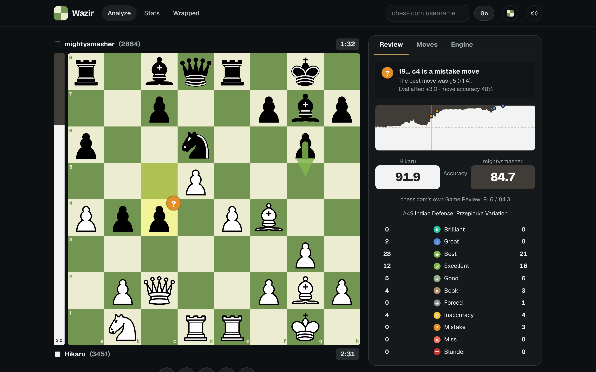
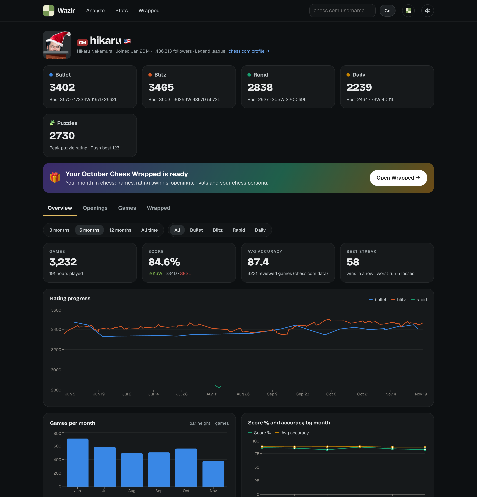
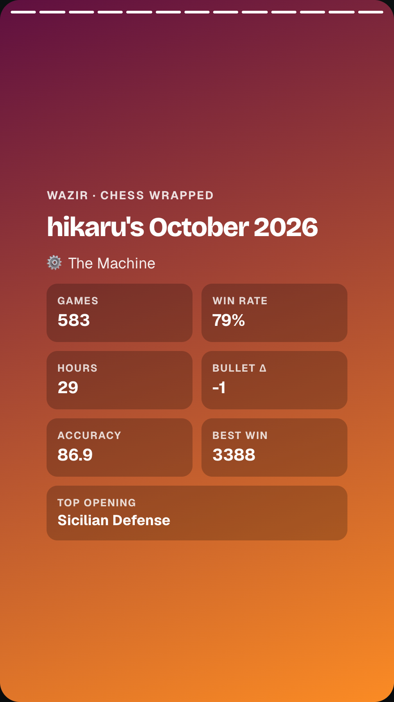

# Wazir website

One-stop site for chess.com players: engine game review, stats & progress, and a monthly / yearly Chess Wrapped
with a soundtrack. Everything runs in the browser. There is no backend: the site calls the chess.com Published-Data
API directly (it sends `Access-Control-Allow-Origin: *`) and runs Stockfish 19 as WebAssembly on the visitor's machine.


## Pages

| Route | What it does |
| --- | --- |
| `/` | Landing page, username search, extension info, FAQ, privacy policy (`/#privacy`, linked from the Chrome Web Store) |
| `/review` | Load a game by chess.com link + username, or paste a PGN |
| `/review/:username/:gameId` | Full review: accuracy, move classifications, explanations, eval graph, best lines, explorable board |
| `/player/:username` | Ratings, rating history, monthly trends, openings, color / opponent / time-of-day splits, all games |
| `/wrapped/:username/:YYYY-MM` | Monthly Wrapped: story slides, soundtrack, downloadable share image |
| `/wrapped/:username/:YYYY` | Yearly Wrapped |
| `/stats`, `/wrapped` | Username entry pages |
| `/privacy` | Privacy policy |



| Stats | Wrapped |
| --- | --- |
|  |  |

## Engine

- **Stockfish 19 full NNUE** (`stockfish` npm package), multi-threaded when the page is cross-origin isolated,
  single-threaded otherwise. A Lite build (~2 MB) is the default on phones and selectable in the Engine tab.
- **Depth presets:** Quick 12 · **Standard 16 (default)** · Deep 20 · Maximum 24. The review pass uses MultiPV 2
  (Maximum: 3) and caps each position's search time; opening-book positions get a quick depth-10 eval. The Engine tab
  searches the viewed position live with 3 lines once the review is done.
- **Speed:** Standard reviews a 102-ply game in ~2 minutes on an 8-core laptop (7 threads). Standard is also the
  setting the accuracy model was calibrated at, so going deeper is slower without matching chess.com any better.
  MultiPV 3 costs 3–10× more than MultiPV 1, and time per position roughly triples every 2 plies past depth 18.
- Every position is searched once; a move's quality comes from the eval before it (best play) vs after it.
- Finished reviews and completed months of chess.com games are cached in IndexedDB.

## Accuracy model

`src/lib/accuracy.ts`. Chess.com's CAPS2 formula is private, so the constants are **fitted to chess.com's own
published accuracies**:

1. Eval (centipawns) → win% with a logistic curve.
2. Per-move accuracy = `103.17 · e^(−decay · win%-loss) − 3.17 + bonus`, 100 for the engine's top move.
3. Game accuracy = harmonic mean of per-move accuracies, each floored at ~25 so a single blunder in a short game
   doesn't drag the score to zero.

| Model | Mean absolute error vs chess.com |
| --- | --- |
| Stock lichess constants | 7.4 |
| Fitted (`ACC_MODEL`), 4-fold cross-validated | 4.1 |
| Fitted, spot check on a later month of unseen games | 2.7 |

The fitted constants only drive the accuracy number. The eval bar, graph and move labels use the standard win% curve,
because chess.com publishes its labels on that scale.

**Move labels** follow chess.com's published expected-points thresholds (Best = top move, Excellent ≤ 2%, Good ≤ 5%,
Inaccuracy ≤ 10%, Mistake ≤ 20%, Blunder > 20% win-chance loss), plus:
Brilliant (a sound piece sacrifice), Great (the only good move), Miss (failing to punish an opponent's error),
Book (lichess CC0 opening database, 3,800+ lines; rebuild with `npm run openings`), Forced (only legal move).

### Recalibrating

Both scripts are opt-in and need network access:

```bash
# 1. Pick chess.com-reviewed games and analyze them (shard across cores)
COLLECT=1 PICK_ONLY=1 OUT=/tmp/calib.json GAMES=56 npx vitest run tests/collect.test.ts
for i in 0 1 2 3; do COLLECT=1 OUT=/tmp/calib.json SHARDS=4 SHARD=$i DEPTH=16 npx vitest run tests/collect.test.ts & done; wait

# 2. Compare against chess.com on any player / month
OUT=/tmp/check.txt CALIBRATE=1 USER_CC=hikaru MONTH=2026/09 GAMES=4 DEPTH=16 npx vitest run tests/calibrate.test.ts
```

Then fit new constants and copy the printed `params` into `ACC_MODEL` (`s` → `slope`, `k` → `decay`, `l` → `blend`, `f` → `floor`):

```bash
node scripts/fit-accuracy.mjs /tmp/calib.0.json /tmp/calib.1.json /tmp/calib.2.json /tmp/calib.3.json
```

## Shared with the Chrome extension

The extension runs this same analysis code. `npm run build:extension` bundles `src/lib/extension-entry.ts`
(engine wrapper, accuracy model, classification, opening book) into `../extention/lib/wazir-core.js` and copies
Stockfish 19 Lite into `../extention/stockfish/`. Re-run it after changing anything in `src/lib`, so the website and
the extension never drift apart.

The extension uses the **Lite** engine (~1.7 MB): Chrome Web Store extensions must bundle their code, and the full
build is ~99 MB. On the 56 calibration games Lite is just as close to chess.com (average gap 3.8 points vs 3.9 for
the full engine). The manifest's `cross_origin_embedder_policy` / `cross_origin_opener_policy` keys make the popup
cross-origin isolated, so Lite runs multi-threaded there too.

## Sound and music

- **Board sounds** (`src/lib/sound.ts`): move, capture, castle, check, promotion, game end and illegal-move sounds,
  synthesized with the Web Audio API, so there are no audio files and no licensing. Toggle in the top bar.
- **Wrapped soundtrack** (`src/lib/music.ts`): five original tracks generated live (synthwave, lo-fi, fast,
  cinematic, upbeat). The track is matched to the player's persona and can be switched or muted. Browsers block
  autoplay, so Wrapped starts with a "Tap to play" screen.
- **Your own songs:** put audio files you have the rights to in `public/music/` and list them in
  `public/music/tracks.json` (format in [`public/music/README.md`](public/music/README.md)). They play first.
  Commercial songs need a license to be played on a public site.

## Design

Dark slate background with deep-green bands and a gold accent, Bricolage Grotesque headings and Geist body text
(Google Fonts). The board defaults to chess.com-style green, with a wood theme in the top bar. Chart colors were
checked for color-blind separation on the dark background.

## Develop

```bash
npm install          # also copies the engine into public/engine (git-ignored, ~200 MB)
npm run dev          # http://localhost:5173 (sends the COOP/COEP headers)
npm test             # unit tests
npm run build        # dist/
```

Screenshots in `docs/screenshots/` were taken against the dev server with headless Chrome.

## Deploy

The site is static (`dist/`), but it needs two things from the host:

1. **Headers for multi-threading:** `Cross-Origin-Opener-Policy: same-origin` and
   `Cross-Origin-Embedder-Policy: require-corp`. Without them the engine silently falls back to **1 thread**, several
   times slower (the Engine tab shows "single-threaded" when this happens). Everything the site loads cross-origin
   (chess.com avatars, Google Fonts) sends `Cross-Origin-Resource-Policy: cross-origin`, so `require-corp` is safe and
   also works in Safari. If you add a new cross-origin image or script, check that it sends that header.
2. **SPA fallback** to `index.html`, or deep links like `/review/...` and `/wrapped/...` return 404.

Both are configured per host:

| Host | File |
| --- | --- |
| **Vercel** (current production) | `vercel.json` |
| Cloudflare Pages / Netlify | `public/_headers` and `public/_redirects` |

Vercel ignores `_headers` / `_redirects`. Set the Vercel project's root directory to `web/` so it picks up
`vercel.json`.

**Large engine files:** `stockfish-19.wasm` and `stockfish-19-single.wasm` are ~99 MB each. Cloudflare Pages rejects
files over 25 MiB, so on Pages upload `public/engine/*.wasm` to an R2 bucket (or any CDN) that serves them with
`Access-Control-Allow-Origin: *` and `Cross-Origin-Resource-Policy: cross-origin`, then build with
`VITE_ENGINE_WASM_BASE=https://your-bucket.example.com/engine/`. Hosts without that limit (Netlify, Vercel, your own
server) can serve everything from `dist/`.

## Credits

Stockfish (GPL-3.0) via stockfish.js · cburnett pieces (CC BY-SA 3.0) · lichess-org/chess-openings (CC0) · chess.js ·
Recharts · Bricolage Grotesque and Geist (SIL OFL). Not affiliated with Chess.com.
